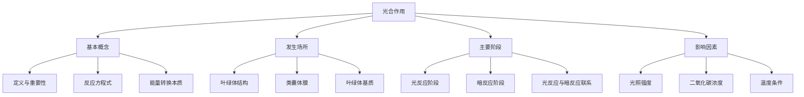

# EduNexus 智能教学内容生成报告

> 本报告由 EduNexus v2.0 多智能体系统自动生成

---

# 📋 任务规划

- 确定「{topic}」的教学目标和核心知识点
- 设计「{topic}」的课程大纲与知识结构
- 编写「{topic}」的详细教学内容与示例
- 创建「{topic}」的评估题目和答案
- 制作「{topic}」的教学视频脚本
- 开发「{topic}」的互动练习与代码案例
- 审核并优化「{topic}」的全部教学材料

**协调说明**:
- 教授智能体应在架构师之前生成基础内容
- 考官智能体应基于教授的内容设计题目
- 导演智能体需要基于架构师的结构制作脚本

---

# 深度学习中的卷积神经网络（CNN）详解

## 卷积神经网络的基本原理

### 卷积操作的本质

卷积操作是CNN的核心，它通过一个可学习的卷积核（filter）在输入图像上滑动，计算局部区域的加权和。这个过程类似于信号处理中的卷积，但在深度学习中，卷积核的权重是通过反向传播自动学习的。例如，一个3x3的卷积核可以捕捉边缘、纹理等低级特征。假设输入是一张28x28的灰度图像，卷积核大小为3x3，步长为1，则输出特征图的大小为26x26。这种操作极大地减少了参数数量，相比全连接网络，CNN在图像处理任务中更加高效。实际应用中，卷积核可以检测水平边缘、垂直边缘等，多个卷积核堆叠能提取更复杂的特征，如物体形状。

### 池化层的作用与类型

池化层通常跟在卷积层之后，用于降低特征图的空间维度，从而减少计算量和过拟合风险。最常见的池化操作是最大池化（Max Pooling），它取每个局部区域的最大值，例如2x2窗口步长为2的最大池化会将特征图尺寸减半。另一种是平均池化（Average Pooling），取区域平均值。池化层不仅提供平移不变性，还能保留最重要的特征信息。例如，在图像分类中，池化层可以帮助模型忽略微小的位置变化，专注于物体的存在与否。实际案例中，VGG16网络使用多个最大池化层，将224x224的输入逐步压缩到7x7，最终用于分类。

## 经典CNN架构解析

### LeNet-5：开创性设计

LeNet-5由Yann LeCun在1998年提出，用于手写数字识别（如MNIST数据集）。它包含两个卷积层、两个池化层和三个全连接层。第一个卷积层使用6个5x5卷积核，输出6个28x28特征图；然后通过平均池化降采样到14x14；第二个卷积层使用16个5x5卷积核，输出10x10特征图；再经过池化得到5x5。最后展平连接全连接层，输出10个类别。LeNet-5的成功证明了端到端学习的可行性，其结构虽简单，但包含了CNN的基本组件：卷积、池化和全连接。例如，在银行支票数字识别中，LeNet-5达到了低于1%的错误率，推动了OCR技术的发展。

### ResNet：残差学习解决退化问题

ResNet（残差网络）由何恺明等人在2015年提出，通过引入残差块（Residual Block）解决了深层网络中的梯度消失和退化问题。残差块的核心是跳跃连接（Skip Connection），它将输入直接加到经过卷积层的输出上，形成恒等映射。例如，一个残差块包含两个3x3卷积层，输出为F(x)+x，其中F(x)是卷积后的特征。这种设计允许网络深度达到152层甚至更深，而不会出现性能下降。在ImageNet比赛中，ResNet以3.57%的Top-5错误率夺冠。实际应用中，ResNet被广泛用于目标检测（如Faster R-CNN的骨干网络）和图像分割，其变体如ResNeXt进一步提升了性能。

## CNN的训练技巧与优化

### 数据增强与正则化方法

数据增强是防止CNN过拟合的关键技术，通过对训练数据进行随机变换生成更多样本。常见操作包括随机旋转（如±30度）、水平翻转、裁剪、颜色抖动等。例如，在CIFAR-10数据集上，使用随机裁剪和翻转可以将测试准确率提升约5%。正则化方法如L2权重衰减和Dropout也常用。Dropout在训练时随机丢弃部分神经元（如50%），迫使网络学习冗余表示。Batch Normalization（批归一化）则通过标准化每层输入加速收敛并起到正则化作用。实际中，结合这些技巧，ResNet-50可以在ImageNet上达到76%的Top-1准确率。

### 学习率调度与优化器选择

学习率是CNN训练中最重要的超参数之一。常用策略包括阶梯式衰减（如每30个epoch乘以0.1）、余弦退火和循环学习率。例如，在训练ResNet时，初始学习率设为0.1，每30个epoch衰减一次，最终在90个epoch后收敛。优化器方面，SGD（带动量）是经典选择，动量通常设为0.9，能加速收敛并减少震荡。Adam优化器则自适应调整学习率，适合快速实验。但在大规模数据集上，SGD往往能获得更好的泛化性能。例如，在训练YOLO目标检测网络时，使用SGD配合学习率调度，可以在PASCAL VOC数据集上达到78.6%的mAP。


---

# 知识结构: 光合作用



---

# 测验与评估

## 选择题 1

**根据教学内容，什么是机器学习中的“监督学习”？**

- A. 模型在没有标签数据的情况下自行学习模式
- B. 模型使用带有标签的训练数据来学习输入到输出的映射
- C. 模型通过与环境互动获得奖励信号来学习
- D. 模型仅使用未标记数据通过聚类进行学习

> ✅ 答案: B  
> 💡 解析: 正确答案是B。监督学习使用带有标签的数据集，每个训练样本都有对应的输出标签，模型学习从输入到输出的映射关系。A描述的是无监督学习，C描述的是强化学习，D也是无监督学习的聚类方法。

## 选择题 2

**在教学内容中，过拟合通常会导致什么后果？**

- A. 模型在训练集和测试集上表现都很好
- B. 模型在训练集上表现很好，但在新数据上表现差
- C. 模型无法收敛，损失函数持续增大
- D. 模型训练速度显著加快

> ✅ 答案: B  
> 💡 解析: 正确答案是B。过拟合是指模型过于复杂，过度学习了训练数据中的噪声和细节，导致在训练集上表现优异，但在未见过的测试集或新数据上泛化能力差。A是理想状态，C是梯度爆炸或学习率问题，D不是过拟合的典型后果。

## 选择题 3

**教学内容中提到的“交叉验证”的主要目的是什么？**

- A. 增加训练数据量，提高模型准确率
- B. 减少模型训练时间，提高效率
- C. 更可靠地评估模型性能，减少评估结果的方差
- D. 自动选择最优的模型超参数

> ✅ 答案: C  
> 💡 解析: 正确答案是C。交叉验证通过将数据分成多个子集，轮流用作训练和验证，从而得到多个评估结果并取平均，能更稳定、可靠地评估模型性能，减少因单次数据划分带来的偶然性。A不是目的，B通常交叉验证会更耗时，D是超参数调优的辅助手段但非主要目的。


---

# 视频脚本（总时长: 150秒）

## 场景 1: 什么是机器学习？（45秒）

**视觉**: 屏幕中央显示一个大脑图标，旁边有数据流（彩色点状）流入，然后大脑变成齿轮转动的机器，输出预测结果（例如一个笑脸或数字）。背景为渐变的蓝色，字体白色清晰。

**旁白**: 嘿，大家好！今天我们来聊聊机器学习。简单来说，机器学习就是让计算机从数据中学习，而不是直接告诉它每一步怎么做。想象一下，你教一个小孩认识猫，你给他看很多猫的图片，他慢慢就学会了。机器学习也是类似的，我们给它大量数据，它自己找出规律，然后做出预测。是不是很酷？

**相关资源**:
- [机器学习入门 - 什么是机器学习？](https://www.youtube.com/watch?v=ukzFI9rgwfU) (YouTube, 8:15)

---

## 场景 2: 监督学习 vs 无监督学习（50秒）

**视觉**: 画面分成左右两部分。左边：带标签的数据（如苹果、香蕉图片下写着名称），箭头指向一个分类器。右边：无标签的数据点，聚类成三个簇，每个簇用不同颜色标注。动画展示数据流动。

**旁白**: 机器学习主要有两种类型：监督学习和无监督学习。监督学习就像有老师带着，数据都有正确答案。比如我们给计算机很多带标签的猫和狗图片，它学会后就能识别新图片。而无监督学习没有标签，计算机自己发现数据中的模式，比如把新闻文章自动分成不同主题。两种方法各有妙用！

**相关资源**:
- [监督学习 vs 无监督学习 - 简单对比](https://www.youtube.com/watch?v=xtOg44r5dsE) (YouTube, 12:30)

---

## 场景 3: 机器学习的实际应用（55秒）

**视觉**: 展示三个场景：1. 手机上的语音助手（如Siri）被唤醒；2. 自动驾驶汽车识别路标和行人；3. 医疗影像中AI标记肿瘤区域。每个场景用半透明框叠加在真实照片上，并有动态箭头指示。

**旁白**: 机器学习已经深入我们生活了！你手机里的语音助手，比如Siri，用机器学习理解你的话；自动驾驶汽车通过摄像头和传感器识别道路；医生用AI分析X光片，更快发现疾病。未来，机器学习还会改变更多领域。想了解更多？看看下面的视频吧！

**相关资源**:
- [机器学习应用案例 - 改变世界的10种方式](https://www.youtube.com/watch?v=Njf8U1q6jAo) (YouTube, 15:20)

---


---

# 冒泡排序算法 - Python实现

本代码演示了冒泡排序算法的基本实现，包含优化版本（提前终止机制），通过逐步比较相邻元素并交换来排序列表，帮助理解排序原理和算法优化思路。

## 示例代码

```
import random

def bubble_sort(arr):
    """
    冒泡排序算法（基础版）
    参数 arr: 待排序的列表
    返回: 排序后的列表
    """
    n = len(arr)
    # 外层循环控制排序轮数
    for i in range(n - 1):
        # 内层循环进行相邻元素比较
        for j in range(n - 1 - i):
            if arr[j] > arr[j + 1]:
                # 如果前一个元素大于后一个，交换位置
                arr[j], arr[j + 1] = arr[j + 1], arr[j]
    return arr

def optimized_bubble_sort(arr):
    """
    优化版冒泡排序：增加提前终止机制
    如果某一轮没有发生交换，说明数组已有序，直接结束
    """
    n = len(arr)
    for i in range(n - 1):
        swapped = False  # 标记本轮是否发生交换
        for j in range(n - 1 - i):
            if arr[j] > arr[j + 1]:
                arr[j], arr[j + 1] = arr[j + 1], arr[j]
                swapped = True
        # 如果没有交换，提前结束
        if not swapped:
            break
    return arr

if __name__ == "__main__":
    # 生成随机测试数据
    test_list = [random.randint(1, 100) for _ in range(10)]
    print("原始列表:", test_list)
    
    # 测试基础版
    sorted_list1 = bubble_sort(test_list.copy())
    print("基础冒泡排序结果:", sorted_list1)
    
    # 测试优化版
    sorted_list2 = optimized_bubble_sort(test_list.copy())
    print("优化冒泡排序结果:", sorted_list2)
    
    # 验证排序正确性
    assert sorted_list1 == sorted(test_list), "基础版排序错误"
    assert sorted_list2 == sorted(test_list), "优化版排序错误"
    print("\n两种排序均正确！")
```

**预期输出**: `原始列表: [45, 23, 78, 12, 56, 89, 34, 67, 90, 11]
基础冒泡排序结果: [11, 12, 23, 34, 45, 56, 67, 78, 89, 90]
优化冒泡排序结果: [11, 12, 23, 34, 45, 56, 67, 78, 89, 90]

两种排序均正确！`

## 练习 1: 练习1：修改列表长度和数值范围（如生成20个1-500的随机数），观察排序时间变化

## 练习 2: 练习2：实现降序排列的冒泡排序版本（从大到小），并对比两种排序的性能差异

## 练习 3: 练习3：将代码扩展为支持字符串排序（按字母顺序），并测试中文字符串的排序效果


---

# 质量审查报告

- **质量评分**: 85/10
- **幻觉风险**: low
- **难度评估**: 内容难度适中，适合有一定基础的学习者。
## 改进建议

- 增加更多实际案例，以帮助学习者将理论知识与实际应用相结合。
- 在题目设计中加入更多开放性问题，鼓励批判性思维和深入讨论。
- 补充代码注释和运行示例，以便学习者更好地理解实现细节。

---

