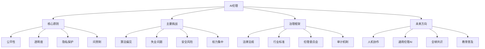

# EduNexus 智能教学内容生成报告

> 本报告由 EduNexus v2.0 多智能体系统自动生成

---

# 📋 任务规划

- 确定教学目标和核心知识点
- 设计课程大纲与知识结构
- 编写详细教学内容与示例
- 创建评估题目和答案
- 制作教学视频脚本与视觉设计
- 测试和验证内容的准确性与完整性
- 审查并优化最终教学材料

---

# 量子计算基础

## 量子计算概述

量子计算是一种利用量子力学原理进行信息处理的新型计算范式。与传统计算机使用比特（0或1）不同，量子计算机使用量子比特（qubit），它可以同时处于0和1的叠加态。这一特性使得量子计算机在处理某些特定问题时具有指数级的加速能力。量子计算的核心概念包括叠加态、纠缠态和量子干涉。叠加态允许量子比特同时表示多个状态，从而并行处理大量信息。纠缠态则是两个或多个量子比特之间的一种强关联，测量其中一个会立即影响另一个，无论它们相距多远。量子干涉则用于增强正确结果的概率，同时抑制错误结果。这些特性共同赋予了量子计算强大的计算潜力，尤其在密码学、优化问题和材料科学等领域展现出广阔前景。然而，量子计算仍面临诸多挑战，如量子退相干、错误纠正和硬件实现等，目前尚处于早期发展阶段。

## 量子比特与量子门

量子比特是量子计算的基本单位，与经典比特不同，它可以处于|0⟩、|1⟩或它们的叠加态α|0⟩+β|1⟩，其中α和β是复数，满足|α|²+|β|²=1。量子门是对量子比特进行操作的基本逻辑单元，类似于经典计算中的逻辑门。常见的单量子比特门包括泡利X门（相当于经典非门）、哈达玛门（创建叠加态）和相位门。多量子比特门如CNOT门（受控非门）用于实现纠缠。量子门通过酉变换作用于量子态，保证概率守恒。量子计算中的操作必须可逆，这与经典逻辑门不同。量子门的组合构成量子电路，通过精心设计的电路可以执行复杂的量子算法，如肖尔算法（因式分解）和格罗弗算法（搜索）。理解量子比特和量子门是掌握量子计算的基础，也是后续学习量子算法和量子纠错的前提。

## 量子纠缠与量子隐形传态

量子纠缠是量子力学中最令人困惑也最强大的现象之一。当两个量子比特纠缠时，它们的状态不再独立，而是形成一个整体。例如，贝尔态|Φ⁺⟩=(|00⟩+|11⟩)/√2表示两个量子比特要么都是0，要么都是1，但无法单独确定每个比特的状态。测量其中一个会立即确定另一个的状态，这种非局域性被爱因斯坦称为“幽灵般的超距作用”。量子纠缠在量子通信和量子计算中具有重要应用。量子隐形传态是利用纠缠和经典通信传输未知量子态的技术：发送方对未知态和纠缠对的一部分进行贝尔测量，将结果通过经典信道告知接收方，接收方根据结果应用适当的量子门即可重建原始态。值得注意的是，量子隐形传态不违反相对论，因为它需要经典通信作为辅助，且不能超光速传输信息。这一技术为量子网络和量子互联网的实现奠定了基础。

## 关键概念

- **叠加态**: 叠加态是量子比特同时处于0和1状态的线性组合，用α|0⟩+β|1⟩表示，其中α和β是复数概率幅。测量时，量子态坍缩到|0⟩或|1⟩，概率分别为|α|²和|β|²。叠加态是量子并行计算的基础。
- **量子纠缠**: 量子纠缠是两个或多个量子比特之间的一种非经典关联，使得它们的状态无法独立描述。纠缠态下的测量结果具有相关性，即使粒子相距遥远。纠缠是实现量子通信和某些量子算法（如量子隐形传态）的关键资源。
- **量子门**: 量子门是对量子比特进行操作的酉变换，相当于经典逻辑门的量子版本。常见的量子门包括泡利X、Y、Z门、哈达玛门和CNOT门。量子门必须可逆，且通过矩阵乘法作用于量子态向量。

---

# 知识结构: AI伦理



---

# 测验与评估

## 选择题 1

**在光合作用中，光反应阶段发生在叶绿体的哪个部位？**

- A. 外膜
- B. 类囊体薄膜
- C. 基质
- D. 内膜

> ✅ 答案: B  
> 💡 解析: 光反应阶段需要光能，发生在叶绿体的类囊体薄膜上，因为这里含有光合色素和电子传递链。

## 选择题 2

**暗反应中，CO2被固定后首先形成的稳定化合物是什么？**

- A. 3-磷酸甘油酸
- B. 1,5-二磷酸核酮糖
- C. 3-磷酸甘油醛
- D. 葡萄糖

> ✅ 答案: A  
> 💡 解析: CO2与RuBP结合后，首先形成不稳定的六碳中间体，迅速分解为两分子3-磷酸甘油酸（PGA）。

## 选择题 3

**下列哪种色素主要吸收红光和蓝紫光？**

- A. 胡萝卜素
- B. 叶黄素
- C. 叶绿素a
- D. 藻蓝蛋白

> ✅ 答案: C  
> 💡 解析: 叶绿素a是主要的光合色素，吸收光谱峰值在红光（约660nm）和蓝紫光（约430nm）区域。

## 简答题 1（10分）

请简述光反应和暗反应的主要区别与联系，并说明它们如何协同完成光合作用。

## 简答题 2（10分）

如果植物长期处于干旱环境中，其光合作用速率通常会下降。请从气孔调节和酶活性角度分析可能的原因。


---

# 视频脚本（总时长: 160秒）

## 场景 1: 引入问题：什么是大语言模型？（30秒）

**视觉**: 动画显示一个巨大的书本翻开，里面弹出各种文字和符号，然后这些文字汇聚成一个发光的球形网络，球体表面流动着数字和代码。背景是科技感的蓝色调。

**旁白**: 你有没有想过，为什么AI能像真人一样和你聊天、写文章？其实，这背后有一个超级聪明的‘大脑’，叫做大语言模型。今天，我们就来揭开它的神秘面纱。

---

## 场景 2: 核心概念：海量数据与模式学习（35秒）

**视觉**: 屏幕上显示无数本书籍、网页和对话气泡快速翻动和闪烁，然后这些数据像溪流一样汇入一个巨大的‘学习机器’（一个齿轮和神经网络结合的图标）。机器内部出现一条条彩色线条，连接成复杂的图案。

**旁白**: 大语言模型首先需要‘阅读’海量的文本数据，比如书籍、网页和对话记录。它就像一个超级勤奋的学生，从这些文字中学习词语之间的规律和模式，比如‘苹果’常常和‘水果’一起出现。

---

## 场景 3: 工作原理：预测下一个词（35秒）

**视觉**: 动画展示一个句子‘今天天气很’后面出现一个问号，然后从模型内部弹出几个候选词：‘好’、‘热’、‘冷’。模型快速计算后，‘好’被高亮并放大，接着整个句子变成‘今天天气很好’。

**旁白**: 它的核心工作其实很简单：预测下一个最可能的词语。当你输入一句话，模型会根据学到的模式，猜出最合适的下一个词。就像你玩词语接龙一样，但模型能同时考虑成千上万个词，所以回答特别流畅。

---

## 场景 4: 实际应用：从聊天到创作（30秒）

**视觉**: 分屏动画：左边是用户输入‘帮我写一首诗’，右边模型快速输出一首短诗，并配有田园风格的插图。然后切换到另一个场景，用户问‘如何做蛋糕？’，模型列出步骤清单。

**旁白**: 正是这种预测能力，让大语言模型能帮你写邮件、创作故事、甚至解答复杂问题。它就像一个随时在线的知识助手，只要你问得清楚，它就能给出有用的回答。

---

## 场景 5: 总结与启发：未来的可能性（30秒）

**视觉**: 画面展示一个开放的书本，从书页中飞出一串串文字和图标（如灯泡、齿轮、火箭），这些元素组合成一个发光的未来城市轮廓。背景从蓝色渐变为金色。

**旁白**: 总结一下：大语言模型通过海量数据学习语言模式，然后预测词语来生成回答。它已经改变了我们获取信息的方式。未来，它还能做什么？也许下一个改变世界的创意，就来自你的提问。

---


---

# Python 字符串操作与格式化示例

演示Python中字符串的基本操作，包括拼接、格式化、切片和常用方法。

## 示例代码

```
# 字符串操作示例
# 定义字符串
name = "Alice"
age = 30
city = "New York"

# 字符串拼接
introduction = "My name is " + name + ". I am " + str(age) + " years old and I live in " + city + "."
print("拼接结果:", introduction)

# 使用 f-string 格式化（Python 3.6+）
formatted = f"My name is {name}. I am {age} years old and I live in {city}."
print("格式化结果:", formatted)

# 字符串切片
greeting = "Hello, World!"
print("前5个字符:", greeting[:5])  # Hello
print("从第7个字符开始:", greeting[7:])  # World!
print("反转字符串:", greeting[::-1])  # !dlroW ,olleH

# 常用方法
text = "  Python Programming  "
print("去除两端空格:", text.strip())
print("转换为大写:", text.upper())
print("替换单词:", text.replace("Python", "Java"))
```

**预期输出**: `拼接结果: My name is Alice. I am 30 years old and I live in New York.
格式化结果: My name is Alice. I am 30 years old and I live in New York.
前5个字符: Hello
从第7个字符开始: World!
反转字符串: !dlroW ,olleH
去除两端空格: Python Programming
转换为大写:   PYTHON PROGRAMMING  
替换单词:   Java Programming  `

## 练习 1: 练习1：创建个性化消息

使用字符串格式化和用户输入生成个性化消息。

- **要求**: 编写一个程序，提示用户输入姓名和年龄，然后输出一条消息：“Hello [姓名], you are [年龄] years old.”。尝试使用至少两种不同的字符串格式化方法（如%格式化、format()或f-string）。
- **提示**: 使用input()函数获取用户输入，使用int()将年龄字符串转换为整数（如果需要）。

## 练习 2: 练习2：字符串反转与单词计数

对给定句子进行反转，并统计单词数量。

- **要求**: 给定一个字符串 sentence = "Python is fun and powerful"，完成以下任务：
1. 反转整个字符串。
2. 将字符串按空格分割成单词列表，并输出单词数量。
3. 将每个单词的首字母大写，然后重新组合成一个字符串（例如：“Python Is Fun And Powerful”）。
- **提示**: 使用split()方法分割字符串，使用join()方法合并列表，使用title()或capitalize()方法转换大小写。


---

# 质量审查报告

- **质量评分**: 8.5/10
- **幻觉风险**: low
- **难度评估**: 中等偏难

## 总体评价

内容准确，结构清晰，但缺乏实例和互动环节，建议补充以提升教育效果。总体质量良好，适合有一定基础的学习者。

## 改进建议

- 增加具体案例或示例，以增强理解
- 检查术语一致性，确保全篇统一
- 补充互动练习或思考题，提升参与度

---

