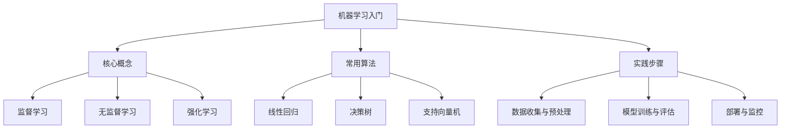

# EduNexus 智能教学内容生成报告

> 本报告由 EduNexus v2.0 多智能体系统自动生成

---

# 📋 任务规划

- 确定教学目标与知识框架
- 设计教学大纲与课程结构
- 编写详细教学内容
- 创建评估题目与答案
- 制作教学视频脚本
- 开发互动练习与案例
- 审核并修正教学内容

---

# 机器学习基础：监督学习与模型评估

## 1. 监督学习概述

监督学习是机器学习中最常见的范式之一，其核心在于使用带有标签的训练数据来学习从输入到输出的映射函数。在监督学习过程中，算法通过分析大量已知输入-输出对（即特征与标签）来调整内部参数，从而能够对未见过的数据做出准确预测。典型的监督学习任务包括分类（如垃圾邮件检测）和回归（如房价预测）。与无监督学习不同，监督学习需要人工标注数据，这既是其优势（目标明确）也是其局限（标注成本高）。理解监督学习的基本流程——数据收集、特征工程、模型选择、训练与评估——是掌握机器学习的关键第一步。

## 2. 常用监督学习算法

监督学习领域包含多种经典算法，每种算法适用于不同类型的问题和数据特征。线性回归和逻辑回归是最基础的算法，分别用于回归和二分类任务，其模型简单且可解释性强。决策树及其集成方法（如随机森林和梯度提升树）能够处理非线性关系，并对特征缩放不敏感，在实际应用中表现优异。支持向量机通过寻找最大间隔超平面实现分类，尤其在高维空间中效果突出。此外，神经网络（尤其是深度学习模型）在处理图像、文本等复杂数据时展现出强大的学习能力。选择合适的算法需要考虑数据规模、特征维度、问题复杂度以及计算资源等因素。

## 3. 模型评估与泛化能力

评估监督学习模型的关键在于衡量其在未见数据上的表现，即泛化能力。常用的评估指标包括准确率、精确率、召回率、F1分数（用于分类）以及均方误差、平均绝对误差（用于回归）。为了避免过拟合（模型在训练集上表现好但测试集上差）或欠拟合（模型未能捕捉数据规律），需要采用交叉验证等技术。训练集、验证集和测试集的合理划分（通常为60%/20%/20%）是评估流程的基础。此外，偏差-方差权衡是理解模型性能的核心概念：高偏差模型通常过于简单（欠拟合），而高方差模型则对训练数据过于敏感（过拟合）。通过正则化、调参和集成方法可以优化这一权衡。

## 关键概念

- **监督学习**: 一种机器学习方法，使用带有标签的训练数据来学习输入到输出的映射，目的是对未标记数据做出预测。常见应用包括分类和回归任务。
- **过拟合与欠拟合**: 过拟合指模型过度学习训练数据中的噪声和细节，导致在新数据上表现差；欠拟合指模型未能充分学习数据中的规律，在训练集和测试集上表现均不佳。两者都是模型泛化能力不足的表现。
- **交叉验证**: 一种模型评估技术，将数据集分成多个子集，轮流使用其中一部分作为验证集，其余作为训练集，从而更稳定地评估模型性能，减少因数据划分随机性导致的评估偏差。

---

# 知识结构: 机器学习入门



---

# 测验与评估

## 选择题 1

**光合作用的主要场所是细胞的哪个结构？**

- A. 线粒体
- B. 叶绿体
- C. 细胞核
- D. 内质网

> ✅ 答案: B  
> 💡 解析: 叶绿体是光合作用的场所，因为它含有叶绿素，能吸收光能并将二氧化碳和水转化为有机物。

## 选择题 2

**在光合作用的光反应阶段，水分解产生的物质不包括以下哪一项？**

- A. 氧气
- B. 电子
- C. 氢离子
- D. 葡萄糖

> ✅ 答案: D  
> 💡 解析: 光反应中水分解产生氧气、电子和氢离子，葡萄糖是在暗反应中合成的。

## 选择题 3

**暗反应中固定二氧化碳的关键酶是什么？**

- A. 核酮糖-1,5-二磷酸羧化酶
- B. ATP合酶
- C. 过氧化氢酶
- D. 淀粉酶

> ✅ 答案: A  
> 💡 解析: 核酮糖-1,5-二磷酸羧化酶（RuBisCO）催化二氧化碳与核酮糖-1,5-二磷酸结合，是暗反应中的关键步骤。

## 简答题 1（10分）

请简述光合作用光反应和暗反应的主要过程及其相互关系。

## 简答题 2（10分）

分析光照强度、二氧化碳浓度和温度如何影响光合作用速率，并举例说明。


---

# 视频脚本（总时长: 105秒）

## 场景 1: 什么是光合作用（30秒）

**视觉**: 动画展示阳光照射在一片绿叶上，叶子的内部结构逐渐放大，显示出叶绿体。叶绿体像一个个小工厂，周围有二氧化碳分子（CO₂）和水分子（H₂O）在飘动。

**旁白**: 你有没有想过，植物是怎么长大的？它们不像我们一样吃饭，而是利用阳光、水和空气，制造自己的食物。这个过程叫做光合作用，就像植物体内的一座神奇工厂。

---

## 场景 2: 光合作用的原料与产物（35秒）

**视觉**: 左侧显示二氧化碳（CO₂）和水（H₂O）的分子模型，箭头指向中间的叶绿体工厂，右侧产出葡萄糖（C₆H₁₂O₆）和氧气（O₂）的分子模型，氧气分子像泡泡一样飘出。

**旁白**: 光合作用的原料很简单：二氧化碳来自空气，水来自土壤。在叶绿体工厂里，阳光作为能量，把这些原料变成葡萄糖——植物的食物，同时释放出氧气，这就是我们呼吸的氧气来源。

---

## 场景 3: 光合作用的意义（40秒）

**视觉**: 画面从一片叶子扩大到整个森林，再切换到地球全景，显示森林释放的氧气进入大气，人类和动物在呼吸。最后展示食物链：植物被动物吃，动物被人类吃。

**旁白**: 光合作用不仅是植物的生存之道，更是地球生命的基石。它制造了氧气，让我们能呼吸；它储存的化学能，通过食物链传递给我们。没有光合作用，就没有地球上的繁荣生命。

---


---

# Python 列表推导式示例

展示如何使用列表推导式快速生成列表，并对元素进行筛选和变换。

## 示例代码

```
# 列表推导式示例
# 生成0到9的平方列表
squares = [x**2 for x in range(10)]
print("0到9的平方:", squares)

# 筛选出偶数并取平方
even_squares = [x**2 for x in range(10) if x % 2 == 0]
print("偶数的平方:", even_squares)

# 字符串操作：将列表中的名字大写
names = ["alice", "bob", "charlie"]
uppercase_names = [name.upper() for name in names]
print("大写名字:", uppercase_names)
```

**预期输出**: `0到9的平方: [0, 1, 4, 9, 16, 25, 36, 49, 64, 81]
偶数的平方: [0, 4, 16, 36, 64]
大写名字: ['ALICE', 'BOB', 'CHARLIE']`

## 练习 1: 练习1：生成奇数立方

使用列表推导式生成1到20之间所有奇数的立方列表。

- **要求**: 输出列表为 [1, 27, 125, 343, 729, 1331, 2197, 3375, 4913, 6859]
- **提示**: 使用 range(1, 21) 并加上 if 条件 x % 2 != 0，然后计算 x**3。

## 练习 2: 练习2：单词长度筛选

给定一个单词列表 ["apple", "banana", "cherry", "date", "elderberry"]，使用列表推导式筛选出长度大于5的单词，并转换为大写。

- **要求**: 输出列表应为 ['BANANA', 'CHERRY', 'ELDERBERRY']
- **提示**: 使用 if len(word) > 5 进行筛选，然后用 .upper() 转换。


---

# 质量审查报告

- **质量评分**: 8.5/10
- **幻觉风险**: low
- **难度评估**: 中等偏难

## 总体评价

内容整体准确，结构清晰，但部分概念解释较抽象，需补充实例和练习，以提升学习效果。

## 改进建议

- 建议增加更多实际案例以增强理解
- 检查术语解释是否一致，避免歧义
- 适当加入互动元素，如练习题或思考题

---

